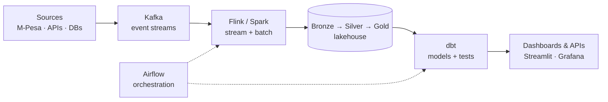

# Victor Kipruto Rop

I design reliable data pipelines, real-time transaction streaming systems, and
lakehouse platforms, with a focus on East African fintech infrastructure.

  
  
  

---

## 👋 About

- 🏗️ I build **batch and streaming pipelines** for transaction data: ingestion, transformation, quality checks, and observability
- 💳 Deep interest in **M-Pesa / Daraja** data: reconciliation, fraud signals, and careful transaction-state handling
- 🧱 I care about systems that are **dependable, observable, and easy to hand over**, built so the next person can understand them

### ✨ Interests

<table>
  <tr>
    <td valign="top" width="50%">
      💸 Fintech &amp; mobile money 
      🌍 Technology for Africa 
      🧠 Machine learning &amp; AI 
      🚀 Building products from scratch
    </td>
    <td valign="top" width="50%">
      ✍️ Writing &amp; sharing what I learn 
      🤝 Open source &amp; collaboration 
      📚 Continuous learning 
      🎬 Film &amp; tech culture
    </td>
  </tr>
</table>

---

## 🧭 How I Build Pipelines

---

## ⚙️ What I Do

| Area | What it looks like in practice |
| :-- | :-- |
| **ETL / ELT** | Reliable workflows for structured and semi-structured data, with batch loading and validation |
| **Real-time streaming** | Event-driven ingestion and processing with Apache Kafka, Flink, and Spark |
| **Modeling & transformation** | Dimensional models, incremental dbt transformations, and data-quality checks |
| **Orchestration** | Airflow DAG design, dependency management, retries, and backfills |
| **Financial data** | Reconciliation-oriented workflows and fraud/anomaly signals on transaction data |
| **Storage & lakehouse** | PostgreSQL, Cassandra, Redis, and Delta Lake |
| **Reliability** | Pipeline metrics, logs, alerts, and data-freshness checks |
| **Platform & DevOps** | Containerized environments, Terraform, Kubernetes, and cloud deployment on AWS |

---

## 🛠️ Tech Stack

<table>
  <tr>
    <td valign="top" width="50%">
      <b>Languages</b> 
      
      
      
    </td>
    <td valign="top" width="50%">
      <b>Streaming & Orchestration</b> 
      
      
      
      
      
    </td>
  </tr>
  <tr>
    <td valign="top" width="50%">
      <b>Databases & Storage</b> 
      
      
      
      
    </td>
    <td valign="top" width="50%">
      <b>Analytics & Observability</b> 
      
      
      
      
    </td>
  </tr>
  <tr>
    <td valign="top" width="50%">
      <b>Infrastructure & DevOps</b> 
      
      
      
      
      
      
    </td>
    <td valign="top" width="50%">
      <b>Data Quality</b> 
      
      
      
    </td>
  </tr>
</table>

---

## 🚀 Featured Projects

<table>
  <tr>
    <td valign="top" width="50%">
      <h4><a href="https://github.com/Victor-Kipruto-Rop/TELIXO">TELIXO</a></h4>
      Real-time M-Pesa transaction streaming pipeline: ingest, process, stream, and analyze events end to end.  
      <code>Kafka</code> · <code>Spark</code> · <code>PostgreSQL</code> · <code>Docker</code>
    </td>
    <td valign="top" width="50%">
      <h4><a href="https://github.com/Victor-Kipruto-Rop/mpesa_safaricom-fraud_anomaly_detection">M-Pesa Fraud &amp; Anomaly Detection</a></h4>
      Streaming fraud engine with ML risk scoring and explainable signals (velocity, SIM-swap correlation, mule networks) feeding a decision engine.  
      <code>Kafka</code> · <code>Flink</code> · <code>dbt</code> · <code>PyTorch</code>
    </td>
  </tr>
  <tr>
    <td valign="top" width="50%">
      <h4><a href="https://github.com/Victor-Kipruto-Rop/cloud-etl-pipeline">Cloud ETL Pipeline</a></h4>
      Fault-tolerant batch pipeline that cleans, validates, and loads 1.6M+ records with automated data checks.  
      <code>Python</code> · <code>PostgreSQL</code> · <code>Docker</code> · <code>Terraform</code> · <code>AWS</code>
    </td>
    <td valign="top" width="50%">
      <h4><a href="https://github.com/Victor-Kipruto-Rop/knbs-cbk-pipeline">KNBS &amp; CBK Indicators Pipeline</a></h4>
      Ingests public economic indicators, models them with dbt, and serves query and CSV APIs with signed cursor pagination, Redis ETag caching, and rate limiting.  
      <code>dbt</code> · <code>PostgreSQL</code> · <code>Redis</code> · <code>Python</code>
    </td>
  </tr>
  <tr>
    <td valign="top" width="50%">
      <h4><a href="https://github.com/Victor-Kipruto-Rop/aws-streaming-fraud-detection">AWS Streaming Fraud Detection</a></h4>
      Real-time transaction monitoring with rule-based anomaly scoring, runnable locally or on AWS.  
      <code>Python</code> · <code>S3</code> · <code>Kinesis</code>
    </td>
    <td valign="top" width="50%">
      <h4><a href="https://github.com/Victor-Kipruto-Rop/victor-kipruto-rop-portfolio">Data Engineering Portfolio</a></h4>
      ETL, streaming, fraud detection, and financial analytics across Kenyan fintech and banking data, with live dashboards.  
      <code>Python</code> · <code>Spark</code> · <code>Streamlit</code> · <code>Grafana</code>
    </td>
  </tr>
</table>

  <a href="https://github.com/Victor-Kipruto-Rop?tab=repositories">👉 Browse all repositories</a>

---

## 📊 GitHub Activity

<a href="https://github.com/Victor-Kipruto-Rop">
  <picture>
    <source media="(prefers-color-scheme: dark)" srcset="https://github-readme-stats.vercel.app/api?username=Victor-Kipruto-Rop&show_icons=true&include_all_commits=true&count_private=true&rank_icon=github&theme=tokyonight&hide_border=true&cache_seconds=86400" />
    
  </picture>
</a>

  

<a href="https://github.com/Victor-Kipruto-Rop">
  <picture>
    <source media="(prefers-color-scheme: dark)" srcset="https://streak-stats.demolab.com/?user=Victor-Kipruto-Rop&theme=tokyonight&hide_border=true" />
    
  </picture>
</a>

---

### 📬 Let's connect

Have a pipeline problem, a collaboration idea, or an opportunity? Reach out.

<a href="mailto:hello@victorkipruto.com">hello@victorkipruto.com</a> ·
<a href="https://victorkipruto.com">victorkipruto.com</a> ·
<a href="https://www.linkedin.com/in/victor-kipruto-rop">LinkedIn</a>

